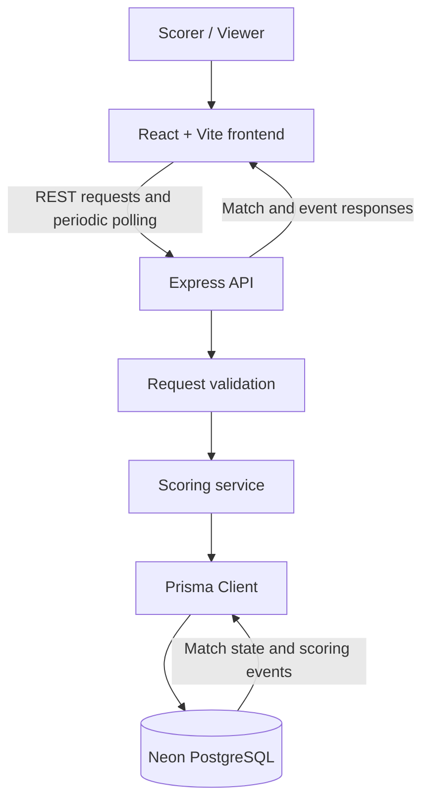

# CourtPulse Architecture

## Overview

CourtPulse uses a React/Vite frontend, an Express/TypeScript REST API, Prisma, and Neon PostgreSQL. The browser polls the API for match updates. Scoring decisions are made on the server rather than trusted to the client.

## Component diagram

## Request flow

1. A scorer performs an action in the frontend, such as starting a match or awarding a point.
2. The frontend sends an HTTP request to the API.
3. The API validates the request and checks the match's current state.
4. The scoring service computes the next valid state.
5. Prisma persists the updated match and scoring-event record in PostgreSQL.
6. The API returns the updated representation or an error.
7. The client continues polling and renders the newest match state without requiring a page reload.

Confirm the exact transaction boundaries and whether the match update and event insert occur atomically by inspecting `src/routes/matches.ts` and `src/services/scoring.ts`.

## Data model

- **Player:** player identity and display name.
- **Tournament:** tournament metadata.
- **TournamentParticipant:** relationship between players and tournaments, unique per tournament/player pair.
- **Match:** players, optional tournament, status, best-of format, score state, winner, version, and timestamps.
- **ScoringEvent:** match event sequence, event type, optional point winner, before/after snapshots, and creation time.

The Prisma schema defines match statuses `SCHEDULED`, `LIVE`, `PAUSED`, and `COMPLETED`. Event types include point awarded/undone and lifecycle events. A schema enum alone does not prove every event type has an implemented route or UI action.

## Scoring and state validation

The scoring service centralizes badminton scoring rules and is covered by unit tests. The API should reject actions that are invalid for the current match status and reject invalid scoring inputs before persistence. Match state is stored in PostgreSQL so the current scoreboard survives a browser refresh.

Review the actual code and tests before claiming support for specific doubles rules, service-side rules, undo behavior, or edge cases beyond the tested scenarios.

## Polling

The frontend uses periodic HTTP requests to refresh the selected match while relevant. Polling is a deliberate alternative to WebSockets or Server-Sent Events because it meets the assignment's polling requirement and is straightforward to operate with a REST API.

Trade-offs:
- **Advantages:** straightforward infrastructure, normal HTTP semantics, easy recovery after transient disconnections.
- **Costs:** extra requests when the score has not changed, and update delay bounded by the polling interval.
- **Potential improvement:** use the match version as a cursor or an ETag/conditional request, if implemented and tested.

Do not document an ETag or version-cursor optimization as implemented unless the current code actually sends and honors it.

## Persistence and audit history

The schema stores scoring events with a per-match sequence constraint and before/after snapshots. This supports traceability and provides data needed for audit or replay workflows. Actual undo/replay functionality must be confirmed in route handlers and tests before being described as available.

## Reliability and validation strategy

- Unit tests cover scoring-service behavior.
- Route tests exercise match API behavior.
- App tests cover application-level endpoints.
- Prisma migrations make database schema changes reproducible.
- The frontend production build should be run as a separate verification step.

## Known limitations to verify before submission

- Confirm exact polling interval and stop/start conditions.
- Confirm all API endpoint request and response schemas.
- Confirm whether undo is implemented beyond the schema enum.
- Confirm whether concurrent score requests use transactions and version checks.
- Confirm frontend production build passes.
- Confirm demo actions work against the configured database.
